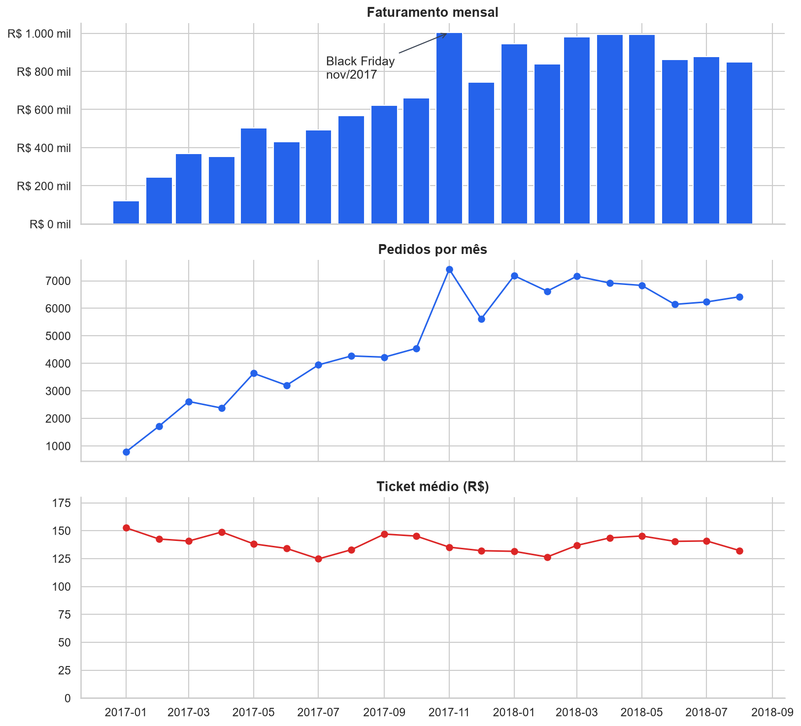
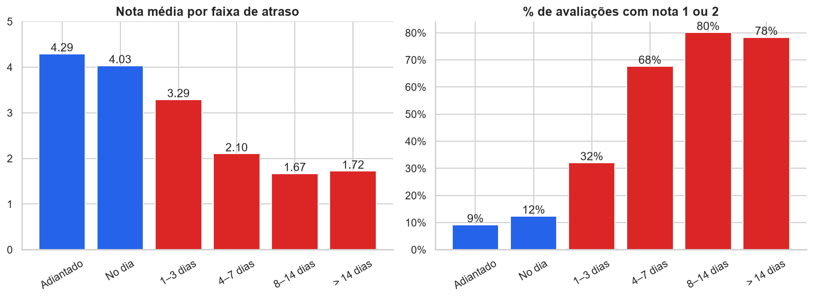
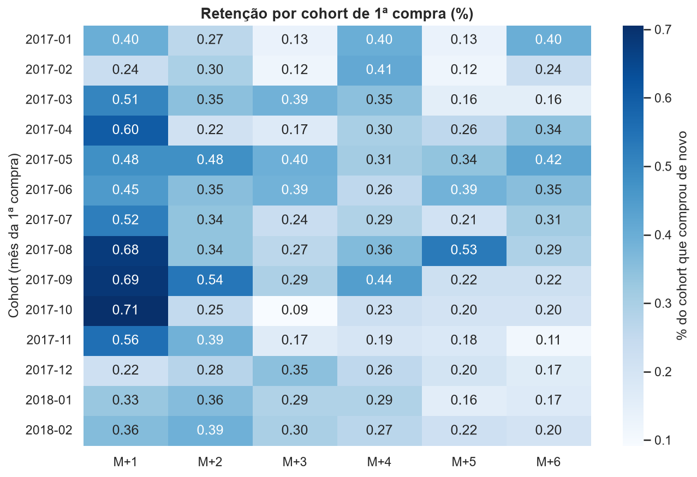
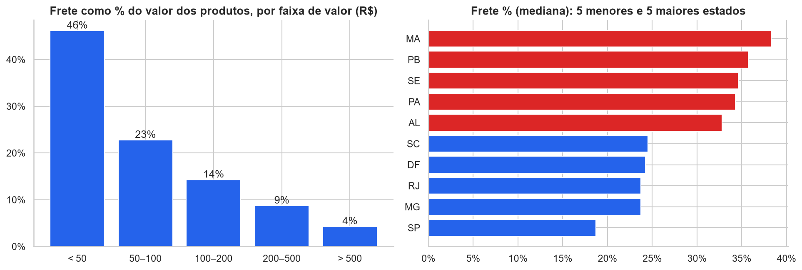

# Análise de E-Commerce Olist: Python (Pandas) + Power BI

Análise de ~100 mil pedidos de um marketplace brasileiro para responder seis perguntas de negócio: **crescimento, concentração de receita, impacto do atraso na satisfação, recompra, desempenho logístico e peso do frete/pagamento**. O projeto vai do dado bruto ao modelo em estrela, com insights e recomendações em cada pergunta.

**Stack:** Python · Pandas · Matplotlib/Seaborn · Parquet · Power BI (DAX)

## O problema
Um marketplace cresce e precisa saber **onde está a receita, onde a operação falha e se os clientes voltam**. Os dados públicos da Olist ([Kaggle](https://www.kaggle.com/datasets/olistbr/brazilian-ecommerce)) trazem 9 tabelas de pedidos, itens, pagamentos, avaliações, clientes, vendedores, produtos e geolocalização entre 2016 e 2018.

## Principais resultados
Janela de análise: **jan/2017 a ago/2018** (R$ 13,4 mi, 97.905 pedidos, ticket médio R$ 137). Fora dela o volume é mínimo (de 1 a 324 pedidos por mês, contra mais de 6.000 em 2018) e distorceria as tendências.

| # | Pergunta | O que os dados mostram | Recomendação |
|---|---|---|---|
| 1 | Evolução do faturamento | Jan–ago/2018 foi **+138%** sobre 2017, impulsionado por volume (o ticket ficou em ~R$ 137). Desde março o crescimento **estacionou**, e de abril a agosto o faturamento caiu **14,6%**. A Black Friday de 2017 deu +52% sobre outubro | Agir em ticket e recompra; planejar a próxima Black Friday |
| 2 | Categorias e estados | **18 de 74 categorias** geram 80% da receita. **SP concentra 38%**, e SP+RJ+MG somam 63% | Concentrar sortimento e marketing nas categorias-chave |
| 3 | Atraso × nota | Pedido atrasado recebe nota **2,27 vs 4,29**; 62% dão nota 1 ou 2 (contra 9% no prazo). Com só 1–3 dias de atraso a nota já cai para 3,29 | Meta de zero atrasos acima de 3 dias; prazos mais conservadores em regiões lentas |
| 4 | Recompra | Só **3,0%** dos clientes compram de novo e geram 5,6% da receita. Quem volta, volta cedo: mediana de **28 dias** | Ação de recompra nos primeiros 30 dias pós-entrega |
| 5 | Logística | O problema é **geográfico**: atraso de **21%** em AL contra 4,5% em SP. Os **37** vendedores com mais de 15% de atraso respondem por apenas 2,8% dos pedidos | Transportadora regional no Nordeste; penalizar os poucos vendedores problemáticos |
| 6 | Frete e pagamento | Em pedidos abaixo de R$ 50, o frete é **46%** do valor dos produtos (mediana); acima de R$ 500, 4%. Ticket em 7–10 parcelas: **R$ 301 vs R$ 100 em 1x** | Testar piso de frete grátis; manter parcelamento |

### Gráficos
<table>
<tr>
<td></td>
<td></td>
</tr>
<tr>
<td></td>
<td></td>
</tr>
</table>

Todos os gráficos e a narrativa completa estão nos notebooks:
[`01_receita_geografia_atraso`](notebooks/01_receita_geografia_atraso.ipynb) (perguntas 1–3) e [`02_retencao_logistica_frete`](notebooks/02_retencao_logistica_frete.ipynb) (perguntas 4–6).

<!--
DASHBOARD (descomentar após montar o .pbix e exportar os prints para docs/img/)

### Dashboard Power BI
Cinco páginas: Visão Executiva, Categorias e Estados, Logística e Satisfação, Clientes e Retenção, Frete e Pagamento.


-->

## Metodologia
1. **Limpeza** (`src/clean.py`): datas convertidas, 1 review por pedido (551 pedidos tinham mais de uma), geolocalização agregada por CEP (1 milhão de linhas para 19 mil CEPs), categorias traduzidas. Cada decisão, com o número que a motivou, está em [`docs/decisoes_limpeza.md`](docs/decisoes_limpeza.md).
2. **Modelagem** (`src/model.py`): esquema estrela com `fact_orders` (grão = pedido), `fact_items` (grão = item) e dimensões de cliente, produto, vendedor e data. Colunas derivadas: dias de atraso, tempo de entrega, flag de recorrência e cohort. Detalhes em [`docs/modelo_dados.md`](docs/modelo_dados.md).
3. **Análise**: Pandas, Matplotlib e Seaborn, com cada pergunta fechando em insight e recomendação.
4. **Power BI**: tabelas exportadas, medidas DAX e roteiro de montagem em [`powerbi/`](powerbi/) e [`docs/powerbi_dashboard.md`](docs/powerbi_dashboard.md), com um **gabarito** de valores esperados calculado em Pandas para validar cada medida.

### Definições de negócio
- **Faturamento** = soma de `price` dos itens (sem frete), só de pedidos válidos (exclui `canceled` e `unavailable`).
- **Atraso** = data de entrega > data estimada, comparando **datas** (não horários).
- **Cliente** = `customer_unique_id` (o `customer_id` muda a cada pedido; usá-lo daria recompra próxima de zero).
- **Taxas de atraso por vendedor/categoria** contam pedidos distintos.

## Limitações
- **Correlação, não causalidade:** a relação entre parcelamento, frete e ticket não prova efeito. A recomendação de frete grátis exige teste A/B.
- **Recompra de 3%** depende de o `customer_unique_id` identificar bem a pessoa; cadastros duplicados subestimariam o número.
- **Amostras pequenas** em estados do Norte/Nordeste (300 a 700 pedidos), então os valores de lá são mais voláteis. As análises por estado usam mínimo de 300 pedidos.
- Os dados cobrem 2016–2018 de um único marketplace, e os números não devem ser extrapolados para o mercado.

## Como reproduzir
Requer Python 3.11+ (desenvolvido em 3.14).

```bash
git clone <URL-DO-REPOSITORIO>
cd <pasta>
python -m venv .venv && .venv\Scripts\activate        # Linux/Mac: source .venv/bin/activate
pip install -r requirements.txt

# 1. Baixe o dataset no Kaggle e coloque os 9 CSVs em data/raw/
python -m src.run_clean        # limpeza            -> data/processed/clean
python -m src.run_model        # modelo estrela     -> data/processed/model
python -m src.export_powerbi   # tabelas Power BI   -> data/processed/powerbi
jupyter lab                    # notebooks 01 e 02
```

## Estrutura
```
├── data/raw/          CSVs originais (não versionados)
├── data/processed/    limpeza, modelo estrela e export p/ Power BI (não versionados)
├── notebooks/         01 e 02: análises com gráficos e insights
├── src/               load, clean, model, viz, export_powerbi
├── powerbi/           medidas.dax e tema de cores (+ .pbix)
└── docs/              decisões de limpeza, modelo de dados, guia do dashboard, gráficos
```

## Créditos
Dataset: *Brazilian E-Commerce Public Dataset by Olist* (Kaggle). Consulte a página do dataset para a licença de uso.
